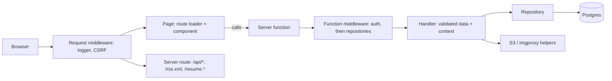
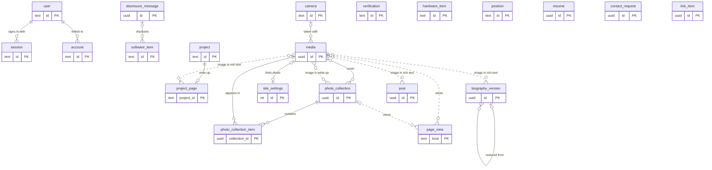
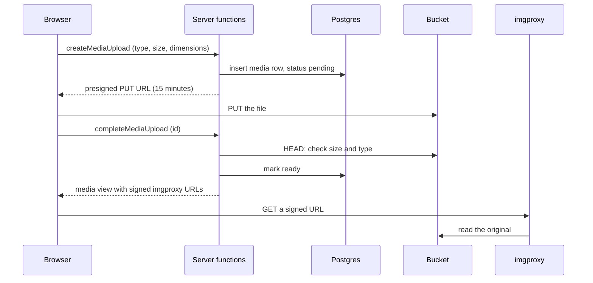

# devsharpe.io

A personal site: a portfolio, a blog ("musings"), photography, and a link-in-bio page, plus the admin dashboard they're all written and managed from. There's no CMS. Content lives in Postgres, images live in an S3-compatible bucket, and everything is edited from `/dashboard` and `/edit/*` after signing in.

- [Stack](#stack)
- [Getting started](#getting-started)
- [Scripts](#scripts)
- [Environment](#environment)
- [Project layout](#project-layout)
- [How a request flows](#how-a-request-flows)
- [Server functions](#server-functions)
- [Middleware](#middleware)
- [Repositories](#repositories)
- [Shared validation (`src/lib`)](#shared-validation-srclib)
- [Data model and relationships](#data-model-and-relationships)
- [Rich text](#rich-text)
- [Media](#media)
- [Authentication](#authentication)
- [Routes](#routes)
- [Migrations and seeding](#migrations-and-seeding)
- [Adding a feature](#adding-a-feature)
- [Conventions](#conventions)
- [Deploying](#deploying)

## Stack

| Concern    | Choice                                                                                                                                                   |
| ---------- | -------------------------------------------------------------------------------------------------------------------------------------------------------- |
| Framework  | [TanStack Start](https://tanstack.com/start) (React 19, TanStack Router file routes, server functions), built with Vite and Nitro (`node-server` preset) |
| Database   | Postgres, with [Drizzle ORM](https://orm.drizzle.team) (1.0 RC) and drizzle-kit migrations                                                               |
| Validation | Zod 4, shared by forms and server functions                                                                                                              |
| Forms      | TanStack Form (`@tanstack/react-form-start`)                                                                                                             |
| Rich text  | [Lexical](https://lexical.dev), stored as its JSON editor state                                                                                          |
| Auth       | [Better Auth](https://better-auth.com) with a generic OAuth provider (DQC's sign-in service)                                                             |
| Media      | Any S3-compatible bucket (RustFS locally), rendered through [imgproxy](https://imgproxy.net)                                                             |
| Styling    | Tailwind CSS v4 and `@tailwindcss/typography`                                                                                                            |
| Bot check  | Cloudflare Turnstile on the contact form                                                                                                                 |
| Analytics  | Plausible (self-hosted), loaded from the root route                                                                                                      |

## Getting started

The local stack runs in Docker Compose: the app, Postgres, RustFS (S3), and imgproxy.

```sh
cp .env.example .env    # then fill in BETTER_AUTH_SECRET and the DQC_* values
docker compose up
```

Open <http://localhost:3000>. Each time the app container starts, [`docker/dev-entrypoint.sh`](docker/dev-entrypoint.sh):

1. Runs `npm ci` if `package-lock.json` changed since the last install. `node_modules` is a Docker volume, so the Linux builds stay separate from the host's.
2. Creates the media bucket and its CORS rules ([`docker/setup-bucket.mjs`](docker/setup-bucket.mjs)).
3. Applies pending migrations (`npm run migrate`).
4. Starts the Vite dev server. The source is bind-mounted, so edits hot-reload.

Compose sets `DATABASE_URL` and every `S3_*` and `IMGPROXY_*` value itself; everything else comes from `.env`. To fill an empty database with the site's content, run:

```sh
docker compose exec app npm run seed
```

Then sign in at `/login` to reach `/dashboard`.

| Service        | URL                                                                | Move it with      |
| -------------- | ------------------------------------------------------------------ | ----------------- |
| App            | <http://localhost:3000>                                            | (fixed)           |
| Postgres       | `localhost:5432` (user, password and database are all `devsharpe`) | `POSTGRES_PORT`   |
| S3 API         | <http://localhost:9000>                                            | `S3_PORT`         |
| RustFS console | <http://localhost:9001>                                            | `S3_CONSOLE_PORT` |
| imgproxy       | <http://localhost:8080>                                            | `IMGPROXY_PORT`   |

`docker compose down -v` deletes the database, the uploaded files, and the installed `node_modules`.

To run without Docker, you need your own Postgres, bucket and imgproxy configured in `.env`. Then run `npm install`, `npm run migrate` and `npm run dev`.

## Scripts

| Script                  | What it does                                                                                                                      |
| ----------------------- | --------------------------------------------------------------------------------------------------------------------------------- |
| `npm run dev`           | Vite dev server on port 3000                                                                                                      |
| `npm run build`         | Production build to `.output/`: the server, plus self-contained builds of the start-up scripts and the seed in `.output/tools`    |
| `npm start`             | Runs the production build (`node .output/server/index.mjs`). The Docker image runs migrations first; see [Deploying](#deploying). |
| `npm run typecheck`     | `tsc --noEmit`. There's no test suite yet, so this is the check to run.                                                           |
| `npm run gen-migration` | Generates a migration in `drizzle/` from changes to the schema                                                                    |
| `npm run migrate`       | Applies pending migrations to `DATABASE_URL`                                                                                      |
| `npm run seed`          | Loads the site's content into the database (see [Seeding](#seeding))                                                              |

Inside Docker, prefix any of these with `docker compose exec app`.

## Environment

See [`.env.example`](.env.example) for every variable, with comments. Server code reads them through `getServerEnv()` in [`src/server/env.server.ts`](src/server/env.server.ts). It reads them on each call, never at module scope.

| Variables                                                                                                                        | Used for                                                                             | Without them                                                    |
| -------------------------------------------------------------------------------------------------------------------------------- | ------------------------------------------------------------------------------------ | --------------------------------------------------------------- |
| `DATABASE_URL`                                                                                                                   | Postgres                                                                             | Nothing works                                                   |
| `BETTER_AUTH_URL`, `BETTER_AUTH_SECRET`                                                                                          | Sessions and the OAuth callback                                                      | Sign-in fails                                                   |
| `DQC_CLIENT_ID`, `DQC_CLIENT_SECRET`, `DQC_AUTHORIZE_URL`, `DQC_TOKEN_URL`, `DQC_USER_INFO_URL`, `DQC_END_SESSION_URL`           | The OAuth provider                                                                   | Sign-in fails                                                   |
| `SITE_TITLE`                                                                                                                     | The site name in the header and the page title                                       | Falls back to a default in `env.server.ts`                      |
| `SITE_SUBTITLE`                                                                                                                  | The header subtitle, until one is saved in the admin                                 | Shows no subtitle                                               |
| `SITE_URL`                                                                                                                       | Absolute links (the RSS feed)                                                        | Falls back to `BETTER_AUTH_URL`, then the request's origin      |
| `VITE_CLOUDFLARE_SITEKEY`, `CLOUDFLARE_SECRET_KEY`                                                                               | Turnstile on `/contact`                                                              | The contact form is switched off                                |
| `S3_BUCKET`, `S3_REGION`, `S3_ENDPOINT`, `S3_PUBLIC_ENDPOINT`, `S3_FORCE_PATH_STYLE`, `S3_ACCESS_KEY_ID`, `S3_SECRET_ACCESS_KEY` | Media and résumé uploads                                                             | Uploads are disabled, and the media library says what's missing |
| `S3_CORS_ORIGINS`                                                                                                                | Optional: origins allowed to upload, applied to the bucket when the container starts | The bucket's CORS rules are left alone                          |
| `IMGPROXY_URL`, `IMGPROXY_KEY`, `IMGPROXY_SALT`, `IMGPROXY_SOURCE_PREFIX`                                                        | Rendering images                                                                     | Images are left out of pages                                    |

## Project layout

```text
.
├── .gitea/workflows/         Builds the production image and pushes it to the registry
├── Dockerfile                Production image (see Deploying)
├── compose.yaml              Local stack: app, postgres, rustfs, imgproxy
├── docker/                   Dev entrypoint, bucket setup, production start script, its build config and package.json
├── drizzle/                  Generated SQL migrations (one folder each)
├── drizzle.config.ts         drizzle-kit: schema path, output folder
├── vite.config.ts            TanStack Start + Nitro + Tailwind + React
└── src/
    ├── start.ts              Request middleware: logging, CSRF
    ├── router.tsx            Router defaults (pending/error/not-found views)
    ├── routeTree.gen.ts      Generated by the router plugin; don't edit
    ├── routes/               File-based routes: pages and server routes
    │   ├── __root.tsx        Document shell, header/footer, <head>
    │   ├── _authenticated.tsx  Sign-in guard for the admin pages
    │   ├── _authenticated/   Admin: /dashboard/*, /edit/*
    │   └── api/              Server routes: auth, health, link clicks
    ├── components/
    │   ├── _ui/              Primitives: buttons, fields, dialogs, toasts, sortable list…
    │   ├── forms/            Admin create/edit forms, one per record type
    │   ├── form-items/       Rows in the admin lists
    │   ├── rich-text/        Lexical editor, toolbar, image nodes, public renderer
    │   ├── media/            Library, picker, uploader
    │   ├── photography/      Collection cards, photo grid, view counting
    │   └── links/            /links icons and click beacon
    ├── forms/context.form.ts useAppForm: TanStack Form wired to the app's field components
    ├── hooks/
    ├── lib/                  Client-safe: constants, Zod schemas, pure helpers
    ├── server/               Server-only code
    │   ├── functions/        Server functions (*.functions.ts): the app's API
    │   ├── middleware/       Function middleware (*.middleware.ts)
    │   ├── repositories/     Database access (*.repository.server.ts)
    │   ├── database/         Drizzle client, schema, relations, ordering helpers, seed/
    │   ├── media/            S3 storage, imgproxy signing, media views
    │   ├── auth.server.ts    Better Auth instance
    │   ├── env.server.ts     Environment access
    │   └── *.server.ts       RSS feed, résumé downloads, link clicks, Turnstile, rich text to HTML
    └── styles/
```

## How a request flows



- **Request middleware** ([`src/start.ts`](src/start.ts)) wraps everything the server handles: SSR documents, server functions and server routes. `requestLogger` logs `[id] METHOD /path 12ms` and sets an `x-request-id` header. `createCsrfMiddleware` guards server function calls.
- **Pages** load data in their route `loader` by calling server functions. During SSR the call runs in-process. On client-side navigation it becomes an RPC request.
- **Server functions** are the app's only API for pages. Each one declares its middleware (which puts repositories into `context`) and a Zod validator, then calls into a repository.
- **Server routes** handle raw HTTP that isn't page data: the Better Auth handler, `/api/health`, the RSS feed, résumé downloads, and the `/links` click beacon.

## Server functions

Server functions live in `src/server/functions/<feature>.functions.ts`. They can be imported from route and component code: on the client, the build replaces each handler with an RPC stub. Everything they import from `*.server.ts` stays on the server.

A typical file, trimmed from [`projects.functions.ts`](src/server/functions/projects.functions.ts):

```ts
import { createServerFn } from "@tanstack/react-start";
import { notFound } from "@tanstack/react-router";
import { setResponseStatus } from "@tanstack/react-start/server";
import { projectInputSchema, projectSlugSchema } from "~/lib/projects";
import { ensure_auth_middleware } from "~/server/middleware/auth.middleware";
import { projects_middleware } from "~/server/middleware/projects.middleware";

// Public read: repository middleware only.
export const getProject = createServerFn({ method: "GET" })
  .validator(projectSlugSchema)
  .middleware([projects_middleware])
  .handler(async ({ context, data }) => {
    const project = await context.projects.getProject(data.slug);
    if (!project) throw notFound();
    return project;
  });

// Admin write: auth first, then the repository.
export const createProject = createServerFn({ method: "POST" })
  .middleware([ensure_auth_middleware, projects_middleware])
  .validator(projectInputSchema)
  .handler(async ({ context, data }) => {
    if (await context.projects.getProject(data.id)) {
      setResponseStatus(409);
      throw new Error(`A project with the slug "${data.id}" already exists`);
    }
    return await context.projects.createProject(data);
  });
```

The conventions:

- **Method.** `GET` for reads, `POST` for anything that writes.
- **Validation.** `.validator()` takes a Zod schema from `src/lib/<feature>.ts`. The admin form validates with the same schema, so the browser checks the input first and the server enforces it. Schemas may transform: `projectInputSchema` turns the form's `status` select into the `isActive` column.
- **Middleware.** Admin functions put `ensure_auth_middleware` first in the array, so an unauthenticated call stops before any database work. After it come the repository middleware the handler needs. A handler that reads several features lists several, for example `[projects_middleware, media_middleware]`.
- **Context.** The handler takes repositories from `context` (`context.projects`), never by constructing them itself.
- **Missing records.** `throw notFound()`. The router shows the not-found view, and admin forms show "It no longer exists".
- **Other failures.** `setResponseStatus(400 | 409 | …)`, then `throw new Error("A sentence for the person")`. The message is what the admin's toast shows.
- **Return values.** Return plain rows or objects. Dates and JSON survive serialization. Create, update and delete functions return something with a `name`, so the form can say "Updated _name_".
- **Composition.** Shared server logic goes in a helper (`resolveRichTextMedia`, `toMediaView`), not in a call from one server function to another.

### Calling them

In a **loader**, call the function directly. It runs on the server during SSR:

```ts
export const Route = createFileRoute("/projects/$slug")({
  loader: ({ params }) =>
    getPublishedProjectPage({ data: { slug: params.slug } }),
  component: RouteComponent,
});
// In the component: const { project, content, media } = Route.useLoaderData();
```

From **components**, usually for writes, wrap the function with `useServerFn`, which hands any redirect the function throws to the router. Then call `router.invalidate()` to re-run the loaders:

```ts
const update = useServerFn(updateProject);
const run = useMutationFeedback("project"); // toasts the outcome
const saved = await run("update", () => update({ data: value }));
if (saved) await router.invalidate();
```

Admin forms follow one shape ([`components/forms/`](src/components/forms)). `useAppForm` comes from [`forms/context.form.ts`](src/forms/context.form.ts), with `validators: { onChange: <schema> }`. `useMutationFeedback` reports the result, and `useConfirm` asks before deleting. Each form takes `RecordFormProps<T>`: `item` to edit or none to create, plus `on_cancel` and `on_saved`.

### Server functions vs. server routes

Use a **server function** for anything a page loads or a form submits. Use a **server route** (`server.handlers` on a file route) when the HTTP contract matters:

| Route                       | Why it's a server route                                                                                           |
| --------------------------- | ----------------------------------------------------------------------------------------------------------------- |
| `/api/auth/$`               | Better Auth's own handler                                                                                         |
| `/api/health`               | Probes and uptime checks                                                                                          |
| `/rss.xml`                  | A feed with `ETag` and `Cache-Control`                                                                            |
| `/resume.pdf`, `/resume.md` | File downloads                                                                                                    |
| `/api/link-click`           | `navigator.sendBeacon` can't send the headers a server function needs. It checks `Sec-Fetch-Site` itself instead. |

## Middleware

There are two kinds of middleware.

**Request middleware** is registered in [`src/start.ts`](src/start.ts) and runs for every request: `requestLogger`, then `csrfMiddleware`. The CSRF check is filtered to server function calls.

**Function middleware** lives in [`src/server/middleware/`](src/server/middleware) and is attached per server function with `.middleware([...])`. Middleware runs in array order, and each one adds to `context` for the next and for the handler.

| Middleware               | Adds to `context`                           | Notes                                                                          |
| ------------------------ | ------------------------------------------- | ------------------------------------------------------------------------------ |
| `ensure_auth_middleware` | `session`, `user`                           | Responds 401 `Unauthorized` without a session. Use it on every admin function. |
| `auth_fn_middleware`     | `session`, `user` (may be empty)            | For functions that work either way                                             |
| `about_middleware`       | `about: AboutRepository`                    | Positions and biography                                                        |
| `contact_middleware`     | `contactRequests: ContactRequestRepository` |                                                                                |
| `gear_middleware`        | `gear: GearRepository`                      | Cameras, hardware, software                                                    |
| `links_middleware`       | `links: LinksRepository`                    |                                                                                |
| `media_middleware`       | `media: MediaRepository`                    | Also needed to resolve images in rich text                                     |
| `photography_middleware` | `photography: PhotographyRepository`        | Collections, photos, views                                                     |
| `posts_middleware`       | `posts: PostsRepository`                    |                                                                                |
| `projects_middleware`    | `projects: ProjectsRepository`              | Projects and their pages                                                       |
| `resume_middleware`      | `resumes: ResumeRepository`                 |                                                                                |
| `site_middleware`        | `site: SiteRepository`                      | The single `site_settings` row                                                 |

Every repository middleware has the same shape:

```ts
export const projects_middleware = createMiddleware().server(({ next }) =>
  next({ context: { projects: new ProjectsRepository(db) } }),
);
```

The context types flow through: after `.middleware([ensure_auth_middleware, projects_middleware])`, the handler's `context` has `user`, `session` and `projects`, all typed.

## Repositories

Repositories ([`src/server/repositories/`](src/server/repositories)) are the only code that writes SQL. Each is a class that takes the Drizzle client (`AppDatabase`) in its constructor and owns one feature's tables:

| Repository                 | Tables                                                                                                                    |
| -------------------------- | ------------------------------------------------------------------------------------------------------------------------- |
| `AboutRepository`          | `position`, `biography_version`                                                                                           |
| `ContactRequestRepository` | `contact_request`                                                                                                         |
| `GearRepository`           | `camera`, `hardware_item`, `software_item`                                                                                |
| `LinksRepository`          | `link_item`                                                                                                               |
| `MediaRepository`          | `media`. It also reads posts, project pages, collections, the biography and site settings to find where an image is used. |
| `PhotographyRepository`    | `photo_collection`, `photo_collection_item`, `page_view`                                                                  |
| `PostsRepository`          | `post`                                                                                                                    |
| `ProjectsRepository`       | `project`, `project_page`                                                                                                 |
| `ResumeRepository`         | `resume`                                                                                                                  |
| `SiteRepository`           | `site_settings`                                                                                                           |

Conventions:

- **Method names.** `list*` returns arrays. `get*` returns one row or `null`. `create*`, `update*` and `delete*` return the affected row, or `null` when it didn't exist, which the server function turns into `notFound()`.
- **Inputs.** Methods take the schema's insert types (`NewProjectItem`, …), which the Zod input schemas already produce.
- **Ordering.** Ordered lists have a `sort_order` column, maintained with two helpers in [`database/ordering.server.ts`](src/server/database/ordering.server.ts):
  - `nextSortOrder(table, column, scope?)` puts a new row at the end of its list. Some tables have more than one list, such as employment and volunteer positions, or active and retired projects. `scope` limits it to one of them.
  - `buildReorderQuery(table, idColumn, ids, scope?)` saves a drag-and-drop order in one statement.
  - Moving a row to the other list, such as an employment position becoming volunteer work, puts it at the end of that list.
- **No business rules here.** Auth, existence checks before writes, and choosing an error status belong in the server function.

## Shared validation (`src/lib`)

`src/lib/<feature>.ts` modules are **client-safe**: constants, Zod schemas, labels and pure helpers that both the admin forms and the server functions import. Two rules:

1. Nothing in `src/lib` may import server-only code or a heavy client library. Only the editor imports Lexical, so the public pages don't bundle it.
2. **Keep imports relative** (`./validation`, not `~/lib/validation`). drizzle-kit loads `schema.server.ts`, which imports enums such as `POSITION_TYPES` from `src/lib`, and drizzle-kit doesn't resolve the `~` alias.

[`src/lib/validation.ts`](src/lib/validation.ts) has the building blocks the feature schemas are made from:

- `identifierSchema`, `toIdentifier`: slugs like `strata-company-2024`
- `requiredText`, `optionalText`: an empty string becomes `NULL`
- `optionalUrl`
- `lineList`: one entry per line of a textarea
- `commaList`: comma-separated input becomes an array
- `tagList`
- `reorderIdsSchema`

## Data model and relationships

The whole schema is in [`src/server/database/schema.server.ts`](src/server/database/schema.server.ts). Solid lines are foreign keys. Dotted lines are references stored inside JSON or by convention, without a foreign key.



### Tables

| Table                                        | Holds                                                                                                | Key                                  |
| -------------------------------------------- | ---------------------------------------------------------------------------------------------------- | ------------------------------------ |
| `user`, `session`, `account`, `verification` | Better Auth's tables, generated by Better Auth                                                       | text ids                             |
| `position`                                   | Employment and volunteer history (`type`), ordered within each type                                  | slug, e.g. `strata-company-2024`     |
| `biography_version`                          | Every saved biography. The newest row is the current one.                                            | uuid                                 |
| `project`                                    | Projects, ordered separately while active and retired (`is_active`)                                  | slug: `/projects/{id}`               |
| `project_page`                               | A project's long-form write-up, with a draft and a published version                                 | `project_id`                         |
| `post`                                       | Posts, with a draft and published content, plus tags, an excerpt and revision dates                  | uuid, plus a unique, editable `slug` |
| `media`                                      | Uploaded images: storage key, `pending` or `ready`, size, alt text, caption, location, camera, tags  | uuid                                 |
| `photo_collection`                           | Collections on `/photography`, with a draft and published write-up and a cover                       | uuid, plus a unique `slug`           |
| `photo_collection_item`                      | Which photos are in a collection, in order. A photo can be in several.                               | (`collection_id`, `media_id`)        |
| `page_view`                                  | View counts for public collection and photo pages                                                    | (`kind`, `target_id`)                |
| `camera`, `hardware_item`, `software_item`   | Gear on `/uses`, each list ordered                                                                   | slugs                                |
| `disclosure_message`                         | An optional note attached to software, such as an affiliate disclosure                               | uuid                                 |
| `resume`                                     | Uploaded résumé PDFs. The `ready` one made current most recently is served.                          | uuid                                 |
| `contact_request`                            | Messages from `/contact`, with `read_at`                                                             | uuid                                 |
| `link_item`                                  | Links on `/links`, with visibility, order and click counts                                           | uuid                                 |
| `site_settings`                              | One row (`id = 1`, enforced by a check constraint): the header subtitle, and the links bio and photo | `1`                                  |

### Foreign keys

| Column                                | References              | On delete                    | Meaning                                              |
| ------------------------------------- | ----------------------- | ---------------------------- | ---------------------------------------------------- |
| `session.user_id`, `account.user_id`  | `user.id`               | cascade                      | Deleting a user signs them out everywhere            |
| `software_item.disclosure`            | `disclosure_message.id` | no action                    | A disclosure can't be deleted while software uses it |
| `project_page.project_id`             | `project.id`            | cascade (also on update)     | The write-up goes with its project                   |
| `media.camera_id`                     | `camera.id`             | set null (cascade on update) | Deleting a camera keeps its photos                   |
| `photo_collection.cover_media_id`     | `media.id`              | set null                     | The cover falls back to the first photo              |
| `photo_collection_item.collection_id` | `photo_collection.id`   | cascade                      |                                                      |
| `photo_collection_item.media_id`      | `media.id`              | cascade                      | Deleting an image takes it out of its collections    |
| `biography_version.restored_from_id`  | `biography_version.id`  | set null                     | Records which version a restore copied               |
| `site_settings.links_photo_media_id`  | `media.id`              | set null                     | Deleting the photo clears it from `/links`           |

### References without a foreign key

- **Images in rich text.** Documents store image nodes as `{ "type": "image", "mediaId": "<uuid>" }` at the top level of the document. Pages resolve the ids when they load (`resolveRichTextMedia`) and skip images that no longer exist. Before an image is deleted, `MediaRepository.findMediaUsage` lists everywhere it appears: posts, project pages, collections, the current biography, and the `/links` photo. It uses a `jsonb` containment query.
- **View counts.** `page_view.target_id` is a collection id or a media id, depending on `kind`. Rows for deleted targets are ignored.
- **Files.** `media.storage_key` and `resume.storage_key` name objects in the bucket. Deleting from the admin removes the object first, then the row. Abandoned uploads are cleaned up later.

### Drizzle relations

[`relations.server.ts`](src/server/database/relations.server.ts) defines Drizzle's relational-query relations for only two cases: `user` ↔ `session`/`account`, which the Better Auth adapter needs, and `softwareItem.disclosure`. Every other join is written out in its repository with `innerJoin` or `leftJoin`, or as a subquery.

### Patterns in the schema

- **Draft and published.** `project_page`, `post` and `photo_collection` each have `draft_content`, `draft_updated_at`, `published_content` and `published_at`. Saving writes the draft. Publishing copies the draft to the published columns, and unpublishing clears them. A record's other fields (title, slug, tags, cover) take effect when saved.
- **Versioned history.** The biography is never overwritten. Each save adds a row, and restoring copies an older row into a new one.
- **Slug keys.** Hand-written records (positions, projects, gear) use a readable slug as the primary key, and a project's slug is its URL. Generated content (posts, media, collections, links, résumés, contact requests) uses uuids.
- **Timestamps.** Most tables have `created_at`, plus `updated_at`, which `$onUpdate` refreshes on every update.

## Rich text

The biography, project pages, posts and collection write-ups are written in a Lexical editor and stored as Lexical's serialized JSON in `jsonb` columns.

| Piece                                                                                            | Where                                                                                      |
| ------------------------------------------------------------------------------------------------ | ------------------------------------------------------------------------------------------ |
| Stored shape and checks: `richTextDocumentSchema`, `hasRichTextContent`, size limit, `isSafeUrl` | [`src/lib/rich-text.ts`](src/lib/rich-text.ts) (client-safe, no Lexical)                   |
| Editor, toolbar, link popover, image nodes                                                       | [`src/components/rich-text/`](src/components/rich-text) (admin only)                       |
| Save, publish and unpublish, with an unsaved-changes guard                                       | `publishing-editor.tsx`, `use-rich-text-document.ts`                                       |
| Public rendering, without Lexical                                                                | `rich-text-renderer.tsx`                                                                   |
| HTML for the RSS feed                                                                            | [`src/server/rich-text-html.server.ts`](src/server/rich-text-html.server.ts)               |
| Resolving image ids to signed URLs                                                               | [`src/server/media/rich-text-media.server.ts`](src/server/media/rich-text-media.server.ts) |

Stored JSON isn't trusted to have come from the editor. The renderer only renders node types it knows and links that pass `isSafeUrl` (http(s), `mailto:`, same-site paths, anchors), and server functions validate documents with `richTextDocumentSchema` before saving.

## Media

Images go straight from the browser to the bucket. The server never handles the file itself.



- **Object keys.** The server generates keys (`media/{id}.{ext}`), never from the file name. An upload whose size or type doesn't match what was declared is deleted.
- **Abandoned uploads.** A row still pending after 24 hours is removed, with its object, the next time something is uploaded.
- **The bucket stays private.** Browsers upload with presigned URLs and imgproxy reads with its own credentials. imgproxy URLs are signed with `IMGPROXY_KEY` and `IMGPROXY_SALT` on the server ([`imgproxy.server.ts`](src/server/media/imgproxy.server.ts)), so only this server can request an image or a size of one.
- **Responsive images.** [`media-views.server.ts`](src/server/media/media-views.server.ts) turns rows into `src` and `srcSet` at 640, 1280, 1920 and 2560px, skipping widths larger than the original, plus a 480px thumbnail.
- **Résumés.** They use the same presigned-upload flow. `/resume.pdf` streams the current PDF from the bucket. `/resume.md` is generated from the positions and projects in the database.

## Authentication

[`src/server/auth.server.ts`](src/server/auth.server.ts) configures Better Auth with the Drizzle adapter and one generic OAuth provider, `dqc`. Its endpoints come from the `DQC_*` variables. `/login` calls `auth_client.signIn.social({ provider: "dqc" })`, and `/api/auth/$` handles the callback.

- **Pages.** [`_authenticated.tsx`](src/routes/_authenticated.tsx) checks the session in `beforeLoad` and redirects to `/login?redirect=…` without one. Everything under `src/routes/_authenticated/` is behind it.
- **Data.** Each admin server function uses `ensure_auth_middleware`. The route guard only hides pages, so the middleware is what actually protects the data.
- **Who's an admin.** Any signed-in session counts. Who can sign in is decided by the OAuth provider's application settings, not by this app.
- **Counting.** Views and link clicks aren't counted while signed in.

## Routes

**Public pages:**

- `/` (home and biography)
- `/posts`, `/posts/$slug`
- `/projects`, `/projects/$slug`
- `/photography`, `/photography/$slug`, `/photography/$slug/$photoId`
- `/uses`, `/employment`, `/contact`
- `/links`: standalone, without the site header and footer, via `staticData.is_standalone`
- `/login`
- `/ai`: a placeholder

**Breadcrumbs.** Public pages show a trail such as Home › Photography › Test Roll › Photo 3 of 12. Each route sets its own crumb with `staticData.breadcrumb`, and the trail follows the route tree. [`Main`](src/components/_ui/main.tsx) renders it ([`breadcrumbs.tsx`](src/components/_ui/breadcrumbs.tsx)), and only when there's a crumb past Home.

- **A fixed label** is a string: `staticData: { breadcrumb: "Gear" }`.
- **A label from the page's data** is a component. For example, `/posts/$slug` uses `function Breadcrumb(): string { return Route.useLoaderData().post.title; }`. The return type has to be written out, because TypeScript can't infer it from a route whose options include it.
- **A section's crumb** goes on its layout route, such as [`posts/route.tsx`](src/routes/posts/route.tsx), so it shows on the list and on every page under it. Index routes don't set one.
- **The crumb for the current page** isn't a link. When the URL has a search, such as `/posts?tag=film`, the section's crumb links back to the whole list.
- **Routes without a crumb** add nothing to the trail. On `/`, `/login` and `/ai` that leaves only Home, so no trail shows. The admin pages set no crumbs either, and keep their own `BreadcrumbNav`.

**Server routes:** `/rss.xml`, `/resume.pdf`, `/resume.md`, `/api/health`, `/api/link-click`, `/api/auth/$`.

**Admin pages**, behind `_authenticated`:

| Path                                                                                              | Manages                                                                              |
| ------------------------------------------------------------------------------------------------- | ------------------------------------------------------------------------------------ |
| `/dashboard`                                                                                      | Overview                                                                             |
| `/dashboard/posts`, `/dashboard/posts/$postId`                                                    | Posts and their editor. `/dashboard/posts/comments` is a placeholder.                |
| `/dashboard/projects`, `/dashboard/projects/$projectId`                                           | Projects, and each project's page editor                                             |
| `/dashboard/collections`, `/dashboard/collections/$collectionId`, `/dashboard/collections/photos` | Photo collections and their photos. `/dashboard/collections/zines` is a placeholder. |
| `/dashboard/media`                                                                                | The media library                                                                    |
| `/dashboard/requests`                                                                             | Contact requests                                                                     |
| `/edit/biography`, `/edit/biography/write`                                                        | Positions, the résumé, and the biography (with its history)                          |
| `/edit/gear`                                                                                      | Cameras, hardware, software                                                          |
| `/edit/links`                                                                                     | `/links`: its photo, bio and links                                                   |

`src/routeTree.gen.ts` is regenerated by the router's Vite plugin when routes change. Don't edit it by hand.

## Migrations and seeding

### Migrations

1. Change [`schema.server.ts`](src/server/database/schema.server.ts).
2. Run `npm run gen-migration`, which writes `drizzle/<timestamp>_<name>/migration.sql` and a snapshot.
3. Read the generated SQL, especially for renames, which drizzle-kit may treat as a drop and an add.
4. Apply it with `docker compose exec app npm run migrate`, or restart the app container.

### Seeding

`npm run seed` loads the site's content from [`src/server/database/seed/`](src/server/database/seed): `data/*.ts` for lists and settings, and `content/*.md` for the biography and project pages. The Markdown is converted to the same Lexical JSON the editor saves. Every entry goes through the same Zod schemas and repositories as the admin.

```sh
npm run seed -- --dry-run        # validate and print; no database access
npm run seed                     # add whatever's missing
npm run seed -- projects links   # only some seeds
npm run seed -- --update         # also overwrite rows that differ from the seed
```

- **Missing rows** are added at the end of their list.
- **Matching rows** are left alone.
- **Rows that differ** are skipped unless you pass `--update`.
- **It never deletes or reorders anything.**
- **With `--update`:**
  - The biography is saved as a new version, so the old one stays in its history.
  - A project page is republished, which replaces its draft.
  - Rich text with images is never overwritten.

Seeds cover the site settings, biography, positions, projects (with pages), hardware, software, cameras and links. They don't cover:

- media, photos or collections
- posts
- contact requests
- the résumé file
- accounts

## Adding a feature

Using a hypothetical "talks" list as the example:

1. **Schema.** Add a `talk` table to `schema.server.ts`, export its select and insert types, add it to the `schema` object, then generate and apply a migration.
2. **Lib.** In `src/lib/talks.ts`, add constants and a `talkInputSchema` built from `validation.ts`, plus id and reorder schemas. Keep imports relative.
3. **Repository.** In `src/server/repositories/talks.repository.server.ts`, write a `TalksRepository` with `list`, `get`, `create`, `update`, `delete` and `reorder`, using `nextSortOrder` and `buildReorderQuery` for order.
4. **Middleware.** `src/server/middleware/talks.middleware.ts` puts `context.talks` in place.
5. **Server functions.** In `src/server/functions/talks.functions.ts`: public reads take `[talks_middleware]`, and admin writes take `[ensure_auth_middleware, talks_middleware]` plus the lib schema as the validator.
6. **Pages.** The public page goes under `src/routes/`, with a loader that calls the read function, and a `staticData.breadcrumb` (see [Breadcrumbs](#routes)). The admin page goes under `src/routes/_authenticated/`.
7. **Forms.** Use `useAppForm` with `validators: { onChange: talkInputSchema }`, `useMutationFeedback("talk")`, and `router.invalidate()` after saving. Use `SortableList` for ordering.
8. **Images.** If talks can show library images, resolve them with `resolveRichTextMedia`, or `toMediaView` for a single image. Add the table to `MediaRepository.findMediaUsage`, so deleting an image warns that it's used there.
9. **Seed data (optional).** Add a `prepareTalks` to `seed/seeders.server.ts` and its data under `seed/data/`.

## Conventions

- **File suffixes.**
  - `*.server.ts`: server-only. The build rejects importing it from client code.
  - `*.functions.ts`: server functions, safe to import anywhere.
  - `*.middleware.ts`: function middleware.
  - `*.repository.server.ts`: repositories.
  - `*.form.ts`: form setup.
- **Naming.**
  - Local variables, props and middleware exports are `snake_case`: `is_editing`, `on_saved`, `projects_middleware`.
  - Functions and hooks are `camelCase`, and components and classes `PascalCase`.
  - Database columns are `snake_case`, mapped to `camelCase` fields in TypeScript.
- **Imports.** Use `~/…` (from `src/`) everywhere except `src/lib` and the files drizzle-kit loads (see [Shared validation](#shared-validation-srclib)).
- **Environment.** Read it through `getServerEnv()` inside functions, never at module scope.
- **Messages.** Error and toast text is written for the person using the admin, as a plain sentence that says what to do next.

## Deploying

Production runs the image built from the [`Dockerfile`](Dockerfile). A Gitea Actions runner builds it and pushes it to the Gitea container registry, and Dokploy pulls it from there, so builds don't take resources from the server the site runs on. Dokploy can also build it from the repository itself, the way dqc-main is deployed.

**The image.** The build stage runs `npm ci` and `npm run build` on `node:26-trixie-slim`. The runtime image takes only three things from it:

- the built server (`.output/server`), with its dependencies bundled in
- the start-up scripts and the seed (`.output/tools`), bundled the same way by [`docker/vite.tools.config.mjs`](docker/vite.tools.config.mjs), with the seed's Markdown next to it
- the migrations' SQL (`drizzle/`)

The runtime base is `node:26-trixie-slim` too, so the container has `bash` and `npm` for debugging, for example in Dokploy's terminal. It has no `node_modules`, so its `package.json` is [`docker/runtime.package.json`](docker/runtime.package.json), whose scripts run the bundled files: `npm run seed` and `npm run migrate`. The whole image is about 89 MB to download, and 56 MB of that is Node and npm. It runs as the base image's non-root `node` user (uid 1000), and the app's files stay owned by root. Node is PID 1 and handles stop signals itself, through the server's graceful shutdown, which usually finishes in about a second.

**Each time the container starts**, [`docker/start.mjs`](docker/start.mjs) does the following, all in the one Node process:

1. Applies pending migrations with [`migrate.server.ts`](src/server/database/migrate.server.ts). It uses drizzle-orm's migrator, which reads the same `drizzle/` folders as `npm run migrate` and records them in the same table, so the two can be used interchangeably. If it fails, for example because the database is unreachable, the container exits with an error instead of serving on an old schema.
2. If `S3_CORS_ORIGINS` is set, runs [`docker/setup-bucket.mjs`](docker/setup-bucket.mjs). It creates the bucket if it's missing and **replaces** its CORS rules with one that lets those origins upload. Leave `S3_CORS_ORIGINS` unset to manage the bucket's CORS yourself.
3. Starts the server on port 3000.

**Health check.** The image's `HEALTHCHECK` requests `GET /api/health` every 30 seconds, after a 60-second start period that covers the migrations. It runs the request with Node, since the image has no `curl`.

### Building on a runner

[`.gitea/workflows/build-image.yml`](.gitea/workflows/build-image.yml) runs on each push to `main`, and by hand from the repository's Actions tab. It builds the image for `linux/amd64` and `linux/arm64`, then pushes it as `gitea.dqc.dev/<owner>/<repository>`, tagged with the short commit hash and `latest`. If `DOKPLOY_WEBHOOK_URL` is set, it then tells Dokploy to deploy. Both platforms share one build stage, which runs on the runner's own platform (the output is plain JavaScript), so the runner needs no emulation.

It needs these repository secrets (Settings → Actions → Secrets):

| Secret                | Value                                                                   |
| --------------------- | ----------------------------------------------------------------------- |
| `REGISTRY_USERNAME`   | A Gitea user that can write the repository's packages                   |
| `REGISTRY_PASSWORD`   | An access token for that user, with package read and write              |
| `DOKPLOY_WEBHOOK_URL` | Optional: the application's deploy webhook URL from Dokploy (see below) |

**Cloudflare's upload limit.** The registry is behind Cloudflare, which rejects any request over 100 MB. A push uploads each layer in its own request, so the limit applies to each layer, not to the whole image. This image's largest layer is Node and npm, at about 56 MB compressed, then Debian, at about 30 MB. The app's own layers are about 2.5 MB. Two things would break that:

- **Copying `node_modules` into the runtime image.** The build stage's `npm ci` layer is about 225 MB compressed.
- **Exporting the build cache to the registry with `--cache-to type=registry,mode=max`.** That pushes the build stage's layers too, `npm ci` included. The workflow keeps no cache between runs, so each run installs the dependencies again.

Pulls aren't affected, since the limit is on what's uploaded.

### Setting it up in Dokploy

**From the registry**, with the workflow above:

1. Add the Gitea registry under Dokploy's registry settings: URL `https://gitea.dqc.dev`, and a user and token that can read the package. Or give the credentials in the application's Docker settings.
2. Create an application with **Docker** as its source, and the image `gitea.dqc.dev/<owner>/<repository>:latest`. Include the registry host: without it, Docker looks for the image on Docker Hub.
3. Turn on Auto Deploy, then copy the application's webhook URL into the repository secret `DOKPLOY_WEBHOOK_URL`. Dokploy deploys on any request to that URL. It only compares image tags for Docker Hub's and GitHub's payloads, and the workflow sends neither. Check the first deploy's log to confirm that Dokploy pulls `latest` again.
4. Add the environment variables below.
5. Point the site's domain at container port **3000**, with HTTPS.

**Or from the repository**: create the application from the Gitea repository instead, with **Dockerfile** as the build type, and turn on Auto Deploy. Dokploy then builds the image itself on each push to the branch it follows. Use one or the other, not both, or each push deploys twice.

Either way, the workflow and Dokploy follow `main`.

### Services it needs

- **Postgres**. Development uses version 18.
- **An S3-compatible bucket**, kept private. Browsers upload straight to it with presigned URLs, so it must be reachable from the browser at `S3_PUBLIC_ENDPOINT` (when that differs from `S3_ENDPOINT`). It also needs a CORS rule allowing `PUT` from the site, set by `S3_CORS_ORIGINS` or by hand.
- **imgproxy**, reachable from the browser at `IMGPROXY_URL`, since pages load images from it. It must use the same key and salt as the app and be able to read the bucket. The `imgproxy` service in [`compose.yaml`](compose.yaml) shows the settings it needs: `IMGPROXY_USE_S3`, the S3 endpoint and credentials, and `IMGPROXY_ALLOWED_SOURCES`.

### Production environment

| Variables                                                                 | Value                                                                                                                            |
| ------------------------------------------------------------------------- | -------------------------------------------------------------------------------------------------------------------------------- |
| `NODE_ENV`, `PORT`                                                        | Set by the image (`production`, `3000`)                                                                                          |
| `DATABASE_URL`                                                            | The production database                                                                                                          |
| `BETTER_AUTH_URL`                                                         | The public origin, e.g. `https://devsharpe.io`. Session cookies are marked secure, and the OAuth redirect URI is built, from it. |
| `BETTER_AUTH_SECRET`                                                      | A long random value, e.g. `openssl rand -base64 32`                                                                              |
| `DQC_*`                                                                   | The DQC sign-in application's client and endpoints. Add `https://<domain>/api/auth/callback/dqc` to its redirect URIs.           |
| `SITE_URL`                                                                | The public origin, for links in the RSS feed                                                                                     |
| `SITE_TITLE`, `SITE_SUBTITLE`                                             | As in development                                                                                                                |
| `VITE_CLOUDFLARE_SITEKEY`, `CLOUDFLARE_SECRET_KEY`                        | A real Turnstile widget's keys, with the domain in its hostnames. Both are read when the server runs, not at build time.         |
| `S3_*`                                                                    | The production bucket and its credentials. `S3_CORS_ORIGINS` (e.g. `https://devsharpe.io`) is optional.                          |
| `IMGPROXY_URL`, `IMGPROXY_KEY`, `IMGPROXY_SALT`, `IMGPROXY_SOURCE_PREFIX` | The public imgproxy URL, and a key and salt that match its own                                                                   |

Never reuse the fixed development values from `compose.yaml` (bucket keys, imgproxy key and salt) in production.

### After the first deploy

1. Load the site's content. Open the application's terminal in Dokploy (`bash`) and run `npm run seed -- --dry-run`, then `npm run seed`. It uses the container's own `DATABASE_URL`, and the content built into the image. Over SSH, `docker exec -it <container> npm run seed` does the same. Or run it from your machine, if the production database is reachable from it: `DATABASE_URL=<production url> npm run seed`.
2. Sign in at `/login`, then upload the résumé and images from the admin.

### Trying the image locally

```sh
docker build -t devsharpe .
docker run --rm -p 3000:3000 --env-file .env.production devsharpe
```

`.env.*` files are ignored by git and Docker, so the file's secrets stay out of commits and images. Its addresses must be reachable from inside the container, where `localhost` is the container itself. Use the other containers' names on a shared Docker network, or `host.docker.internal` to reach the host.
